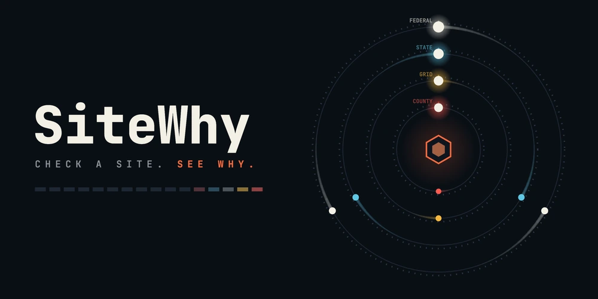
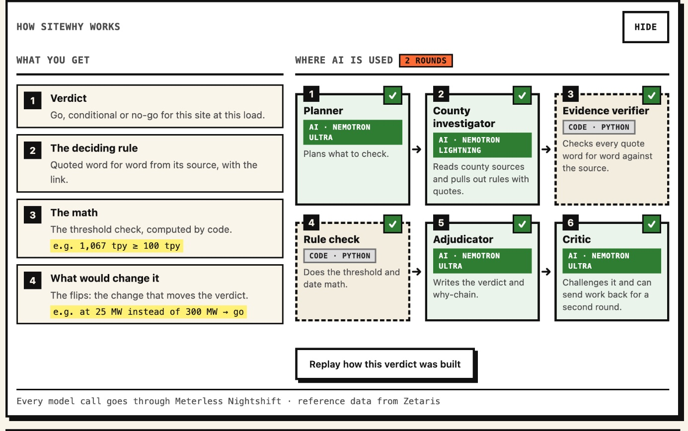
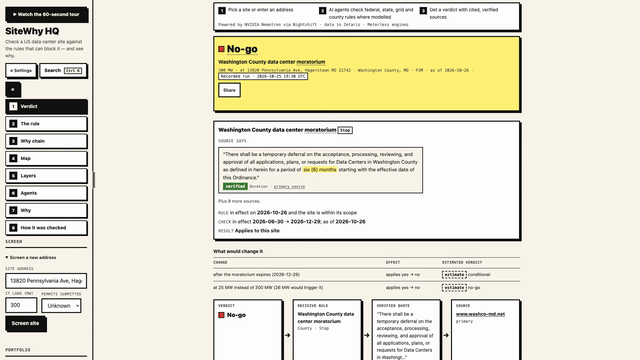
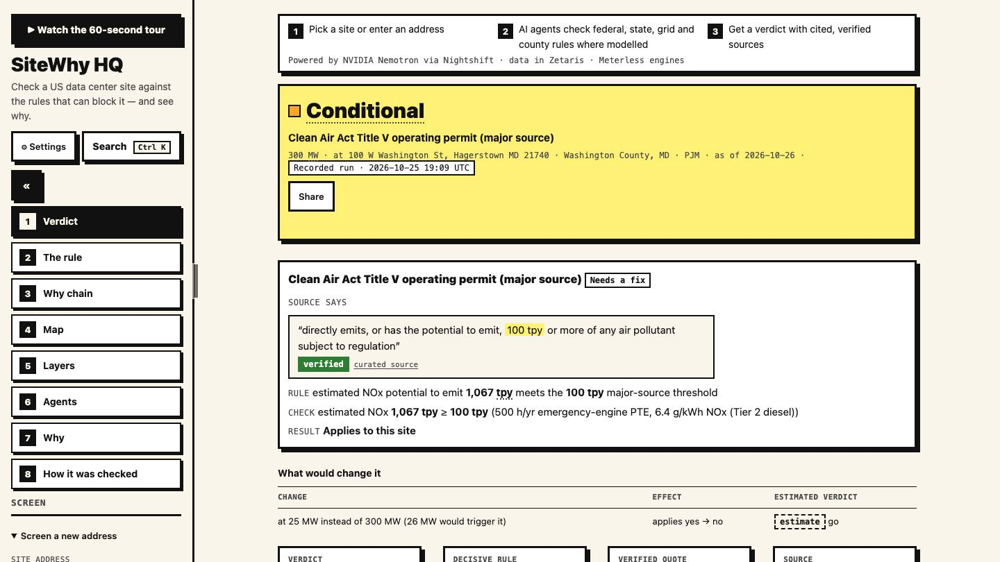
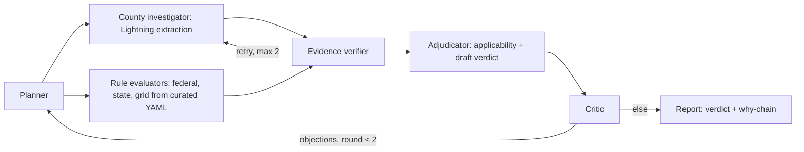

<div align="center">

<a href="#-demo-video">
  <picture>
    <source media="(prefers-reduced-motion: reduce)" srcset="docs/img/cover-poster.png">
    
  </picture>
</a>

# SiteWhy

**Check a site. See why.**

Check a US data center site against the rules that can block it, and see exactly why.

[](#-what-sitewhy-does)
[](#-sponsor-tech)
[](#-sponsor-tech)
[](#%EF%B8%8F-zetaris-unified-semantic-layer)
[](#-dependencies)

[Demo video](#-demo-video) · [Quick start](#-quick-start) · [How it works](#-how-it-works) · [Sponsor tech](#-sponsor-tech) · [Examples](#-examples-and-traces) · [Limitations](#%EF%B8%8F-limitations)

</div>

---

SiteWhy takes a US address and an IT load in megawatts and checks the site against federal, state, grid and county rules. It returns a go, conditional or no-go verdict, and every verdict comes with the verified rule text, the applicability math and the changes that would flip the answer. It is a screening tool for early site triage; it gives no legal advice.

## 👀 At a glance

<p align="center">
  
</p>

Every screening hands back four things: the verdict, the rule that decides it quoted word for word, the math behind it, and what would change the answer. The green steps are Nemotron calls through Meterless Nightshift. The dashed steps are plain Python, so the quote check and the threshold math stay deterministic. During a run the pipeline lights up step by step, and "Replay how this verdict was built" plays a finished report's own trace back.

## 🎬 Demo video

The 3:02 narrated demo plays right here:

https://github.com/user-attachments/assets/be00c388-8424-462f-ad70-bf472b78f5d2

The full-quality 1080p file is in the repository: [`submission/video/OAH2026-SiteWhy-ExplainWhy-Demo.mp4`](submission/video/OAH2026-SiteWhy-ExplainWhy-Demo.mp4) (27 MB, download). The clip below is the in-app guided tour.

<p align="center">
  
</p>

## ⚡ Quick start

No keys needed. Sample mode runs the real orchestration, verification and applicability code and replays recorded model answers.

**Docker**

```bash
docker build -t sitewhy .
docker run -p 8000:8000 sitewhy
```

Open http://localhost:8000 and pick a showcase site. The image starts in sample mode.

**uv**

```bash
git clone https://github.com/wjgoarxiv/sitewhy.git && cd sitewhy
uv sync
SAMPLE_MODE=true uv run uvicorn app.main:app --port 8000
```

**One screening from the command line**

```bash
SAMPLE_MODE=true uv run python run.py --input input_examples/md-washington-county-unincorporated.json --sample --output /tmp/report.json --logs-dir /tmp/traces
```

This prints the report JSON (checked on 2026-10-27: exit 0, verdict `no-go`), writes it to the output path and saves the agent trace as JSONL in the logs folder.

## 🧭 Why it matters

Data center moratoria now spread faster than a developer can track: 321 moratoria or restrictions across 32 states as of September 2026 ([Electric Choice tracker](https://www.electricchoice.com/datacenters/moratoriums/)), plus a New York statewide moratorium under Executive Order 62 (7/2026).

Listing tools such as Acres.com, Cherre DataCenter Intel, LightBox, Transect and C&W Athena show rules and scores. The harder question is whether a rule applies to *this* site at *this* load. SiteWhy answers that one, with the quote, the threshold math and the flips that would change the verdict.

**Who it is for:** site selectors and developers triaging US greenfield sites before they spend on legal review and interconnection queues.

## ✨ What SiteWhy does

| | Capability | How it works |
|---|---|---|
| 🧮 | **Deterministic applicability** | Python decides whether each rule applies, from the project facts. Title V applies when the estimated NOx potential to emit reaches 100 tpy; Texas SB 6 applies at 75 MW or more. |
| 🔎 | **Verified quotes** | Every claim carries the verbatim rule text, its source URL and an as-of date. A fatal finding whose quote fails verification is downgraded to major. |
| 🔁 | **Computed flips** | Each decisive finding lists what would change it: permit timing, the MW threshold, moratorium expiry, incorporated versus unincorporated scope. |
| 🛡️ | **Critic loop** | A red-team critic objects to the draft verdict, and the planner re-investigates the targeted questions before the final report. |

<table>
  <tr>
    <td width="33%"></td>
    <td width="33%"></td>
    <td width="33%"></td>
  </tr>
  <tr>
    <td align="center"><sub>No-go with the verified moratorium quote</sub></td>
    <td align="center"><sub>Threshold math and what would flip it</sub></td>
    <td align="center"><sub>Which model handled each request</sub></td>
  </tr>
</table>

## 🧠 How it works



| Role | Model or implementation | Reads | Writes |
|---|---|---|---|
| Planner | Nemotron Ultra | jurisdiction, project facts, critic objections | investigation tasks per layer |
| County investigator | Lightning extraction through the Markovian chunked loop; Ultra re-extracts when Lightning returns no facts | tasks, seed layers, fetched sources | candidate rules and claims with quotes |
| Evidence verifier | deterministic code: verbatim substring match against the fetched source | claims | verified / not_found / unverifiable per claim |
| Applicability tool | deterministic Python | rules, project facts | applies yes/no with computed values |
| Adjudicator | Nemotron Ultra | verified claims, applicability results | draft verdict and why-chain |
| Critic | Nemotron Ultra with a red-team prompt | draft verdict and the World Model graph | objections that send the planner back |

All roles share one state store, the World Model log (one JSONL file per run). Every message between roles is a typed event, and the UI trace shows them as they arrive (the client polls every 1.5 s). Federal, state and grid rules come from curated YAML evaluated by code; the county investigator is the only role that calls a model for extraction.

Live screenings run one at a time. A cooperative 10-minute (600 s) deadline returns a partial `needs_confirmation` report, and a second concurrent POST gets a 409.

## 🔌 Sponsor tech

**Meterless Nightshift, the primary AI provider.** Every model call goes through Nightshift (`app/llm.py`) with no bypass. The model and compute receipt for each request are recorded in `model_trace` and shown in the UI agent lanes. Each call has a timeout and retry handling.

**NVIDIA Nemotron.** `nvidia/nemotron-3.5-lightning-30b-a3b` extracts rules and quotes for the county investigator. `nvidia/nemotron-3-ultra-550b-a55b` plans, adjudicates and critiques. Quote verification is deterministic code (`app/evidence.py`) with no model call; the `classify` and `verify_support` entries in `STEP_MODELS` are unused.

**Zetaris, the data layer.** The agents query the Zetaris `moratoria` and `state_legislation` tables at run time. Every recorded live run, including the 50 MW run, succeeded with the request headers the app sends (see `data_trace` in `samples/*.json`). When Zetaris is unreachable, DuckDB serves the same SQL (`app/data.py`). The Unified Semantic Layer below is a separate, working artifact; the agent loop does not query it yet.

**Meterless World Model.** The shared, provenance-stamped rule and evidence graph that every agent reads and writes (`app/worldmodel.py`, Apache-2.0 spec). Each run appends a JSONL audit log.

**Meterless Markovian.** Bounded-context chunked reasoning drives the county investigation (`app/markovian.py`, with conformance and behavior tests). The sample-mode replays span up to 4 Markovian chunks and the live showcase samples 2, with 0 tokens saved at current source sizes. The engine and its token accounting are implemented and tested.

**Cursor.** The `Dockerfile` and `.dockerignore` were written in a Cursor Agent CLI session (commit `30d5b90`). The rest was built with Claude Code.

**What is distinctive.** The applicability engine and the critic loop sit between model calls. Models propose and deterministic code decides, so every verdict traces back to a quote plus arithmetic.

## 🗄️ Zetaris Unified Semantic Layer

`SITEWHY.usl_site_screen` has 1,291 rows, one per moratorium instrument. It joins four registered sources: `moratoria`, `state_legislation`, `curated_rules` (from `data/layers/rules.yaml`) and `county_sources` (from `data/layers/county_sources.yaml`).

- DDL: `zetaris/usl.sql`. Automation: `scripts/zetaris_usl.py`.
- Exploratory queries per source, USL queries and run receipts: `zetaris/evidence/`.
- One data-quality rule, `null_join_keys`, runs on every build and passes when it returns zero rows.

On this Zetaris instance, plain Spark views do not persist across SQL-editor proxy requests, so the USL is materialized: the build query writes `data/seed/usl_site_screen.csv`, which is registered as a Lightning filestore table. `zetaris/REFLECTION.md` covers time saved, where the USL helps, and what would make it stronger.

## 📊 Evaluation

- Ground truth: 3 of 3 sites match (Washington County MD unincorporated, Abilene TX/ERCOT, Tucson/Pima AZ), in `data/eval/results.json`.
- Seeded critic faults: 3 of 3 caught (`fatal-pima`, `title-v-below-threshold`, `washington-missed-exemption`), in `data/eval/results.json`. This is a regression check on the development sites, without a held-out accuracy number.
- Test suite: 177 passed (`uv run pytest -q` in a fresh clone, 2026-10-27).

Recorded model usage across the 5 samples in `samples/*.json`, counted from their `model_trace`:

| Model | Calls | Total tokens | Latency, ms (sum) |
|---|---|---|---|
| nvidia/nemotron-3-ultra-550b-a55b | 20 | 127037 | 979744 |
| nvidia/nemotron-3.5-lightning-30b-a3b | 12 | 62333 | 80927 |
| **Total** | **32** | **189370** | **1060671** |

Latency totals are wall-clock sums across recorded runs, useful for scale only.

## 📁 Examples and traces

Recorded showcase reports (`samples/`, live Nightshift runs) next to sample-mode replays (`output_examples/`, cached replay pinned to 2026-10-26):

| Sample | Input | Recorded verdict | Replay verdict |
|---|---|---|---|
| `md-washington-county-unincorporated` | 13820 Pennsylvania Ave, Hagerstown MD 21742 · 300 MW · permits not submitted (recorded 2026-10-25) | no-go | no-go |
| `md-hagerstown-city` | 100 W Washington St, Hagerstown MD 21740 · 300 MW (recorded 2026-10-25) | conditional | needs_confirmation |
| `tx-abilene-ercot` | 555 Walnut St, Abilene TX 79601 · 300 MW (recorded 2026-10-25) | conditional | conditional |
| `tx-abilene-ercot-50mw` | same site · 50 MW (recorded live 2026-10-27, 2 Nemotron calls; no cached replay) | conditional | — |
| `az-tucson-pima` | 255 W Alameda St, Tucson AZ 85701 · 300 MW (recorded 2026-10-25) | conditional | conditional |

**The scope flip is the headline.** Same county, two answers: unincorporated Washington County is no-go under county moratorium ORD-2026-12, while incorporated Hagerstown is conditional because the county ordinance stops at the city line.

**The 50 MW contrast.** The same Abilene site at 50 MW stays conditional with a different rule mix: SB 6 and the ERCOT audit flip while Title V still applies.

Showcase reports carry a "Recorded run" badge with the run date.

- `input_examples/`: the 4 showcase inputs (address, MW and permits exactly as recorded).
- `output_examples/`: the reports `run.py --sample` produced from them, generated rather than copied.
- `output_examples/traces/*.jsonl`: committed reference traces, one JSON object per agent event with `timestamp, agent_name, action, input_summary, output_summary, target_agent, model, retry_count, status`. The target agent is the next event's role (the real handoff), and the model is that role's model from `model_trace`.
- Local runs write fresh traces to `logs/` (git-ignored). Each `samples/*.json` report also carries `model_trace` (model per request), `markovian_runs` and `events`.

## 🛠️ Setup and usage

### Live mode with Zetaris and Nightshift

Copy `.env.example` to your keys file (outside the repo, never committed) and fill in:

- `NIGHTSHIFT_BASE_URL` (default `http://127.0.0.1:8088/v1`), plus `NIGHTSHIFT_TOKEN_FILE` or `METERLESS_RUNTIME_TOKEN`
- `ZETARIS_BASE_URL`, `ZETARIS_ORG_ID`, `ZETARIS_API_KEY`

`scripts/zetaris_usl.py` registers the seed tables and builds the USL (DDL in `zetaris/usl.sql`). When Zetaris is unreachable, DuckDB serves the same SQL from the bundled seed data. Then start the server:

```bash
uv run uvicorn app.main:app --port 8000
```

Without keys the app still boots, and live features report "not configured".

For Docker in live mode, pass the keys with `--env-file` and point Nightshift and Zetaris at `host.docker.internal`.

### API

```bash
curl -s -X POST localhost:8000/runs -H 'content-type: application/json' \
  -d @input_examples/md-hagerstown-city.json
curl -s localhost:8000/portfolio | python3 -c "import json,sys; print(sum(r.get('kind') == 'showcase' for r in json.load(sys.stdin)), 'showcase reports')"
```

`run.py` takes `--input`, `--sample`, `--output` and `--logs-dir` (`--help` for details). Sample mode replays only the recorded inputs in `input_examples/`, field for field; any other body fails at once and names `input_examples/`. In live mode, any body with `address` and `mw` works, for example `{"address":"100 W Washington St, Hagerstown MD 21740","mw":300}`. Errors come back as a JSON message. A second concurrent POST gets a 409 while a screening holds the run lock.

In the browser, sample mode says: "Sample mode: runs replay recorded model answers for the showcase addresses." Dates pin to `SAMPLE_MODE_AS_OF` (2026-10-26, `app/config.py`), the day the committed caches were recorded.

### 📦 Dependencies

Python 3.12+ and `uv`. Runtime: fastapi, uvicorn, httpx, duckdb, pypdf, beautifulsoup4, pyyaml (see `pyproject.toml`). Dev: pytest, pytest-asyncio, ruff. A local GPU is unnecessary.

<details>
<summary><b>Troubleshooting</b></summary>

- `Nightshift is not configured (token missing)`: set `NIGHTSHIFT_TOKEN_FILE` or `METERLESS_RUNTIME_TOKEN` in `~/.hackathon-keys.env`, or run with `SAMPLE_MODE=true` / `run.py --sample`.
- `Zetaris is not configured`: set `ZETARIS_BASE_URL`, `ZETARIS_ORG_ID` and `ZETARIS_API_KEY`; DuckDB serves the bundled seed data meanwhile.
- Configuration comes from the environment and `~/.hackathon-keys.env`; the app reads no `.env` file.
- Port in use: serve on another port, for example `SAMPLE_MODE=true uv run uvicorn app.main:app --port 8010`.

</details>

<details>
<summary><b>Development</b></summary>

```bash
uv run pytest -q
uv run ruff check .
```

</details>

## ⚠️ Limitations

- **Borderline verdicts can change between runs.** `md-hagerstown-city` was recorded as conditional (round 2); the cached replay used by sample mode reaches needs_confirmation. Both are real runs.
- **Sample mode replays model text.** The orchestration, verification and applicability code runs for real while the LLM answers come from cache, so a sample-mode verdict can differ from the showcase report for the same input.
- **Run time.** Recorded model time is about 1.5–3 minutes for most sites and about 6 minutes for Hagerstown, against the 10-minute (600 s) cooperative deadline. A run past the deadline stops with a partial `needs_confirmation` report, and the client poll loop gives up 60 s later with "The run did not finish in time — try again".
- **Title V is an estimate.** It uses the potential to emit from assumed backup generators (N+1 units of 2.5 MW diesel, 500 h/yr, 6.4 g/kWh NOx) against the 100 tpy threshold, so it flips between 25 and 26 MW. The 75 MW figure belongs to the Texas SB 6 / ERCOT large-load rules.
- **The Zetaris USL stands apart.** `scripts/zetaris_usl.py` builds and demonstrates it; wiring the agents to it comes next.
- **County evidence is early-stage.** It comes from a draft ordinance, a press release and a news article, with quotes verified word for word against them. Adopted ordinance text is outside the current source set.
- **Markovian savings are still zero.** The engine is implemented and tested; on current sources it saved 0 tokens (up to 4 chunks in the replays, 2 in the live samples).
- **Rules are curated.** Seed rules are hand-curated with quotes verified at run time; autonomous rule discovery is on the roadmap.
- **Coverage.** Any US address is resolved and screened against the federal Title V rule and the 1,291-entry moratorium dataset. State and grid rules are modelled for Texas/ERCOT. County sources cover Washington County MD and Pima County AZ. Other states get a federal-only report with a scope note (UI: "AI agents check federal, state, grid and county rules where modelled").
- **Prototype.** Single user, no auth, US only.

## 📜 Data licenses

| Data | Source | License |
|---|---|---|
| Moratorium inventory (1,291 entries) and state legislation (440 rows), `data/seed/moratorium_nation/` | Moratorium Nation by Michael Bommarito, refreshed 2026-09-23 | CC-BY-4.0 (data) |
| County-to-utility subset, `data/seed/`, built by `scripts/build_geo.py` | U.S. EIA Form 861 2025 | Public domain |
| Geocoder cache | U.S. Census Geocoder | Public domain |
| County and place context | U.S. Census TIGERweb | Public domain |
| Transmission lines | HIFLD Electric Power Transmission Lines | Public domain |
| Map tiles | Esri Dark Gray Canvas / World Imagery | Esri proprietary, attribution shown on the map |
| Cached source texts (6 files), `data/sources/` | public pages (governor press releases, county notices), cached at record time for sample-mode replay | same terms as the underlying pages |

World Model and Markovian engine specs: Meterless, Apache-2.0. The submission declares the pre-existing third-party material (pre-window datasets and the Meterless specs); all product code was written during the build window.

## License

There is no license file yet; the entrant keeps all IP. Third-party data and engine specs keep their own licenses, listed above.

---

<div align="center">

[Demo video](#-demo-video) · [Quick start](#-quick-start) · [How it works](#-how-it-works) · [Sponsor tech](#-sponsor-tech) · [Evaluation](#-evaluation) · [Data licenses](#-data-licenses)

<sub>Built for the GenAI Works Open Agent Hackathon 2026 · Track 2, The Agent That Can Explain Why</sub>

</div>
