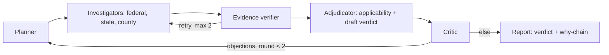

# SiteWhy

Check a US data center site against the rules that can block it — and see why.

Track: **The Agent That Can Explain Why**. SiteWhy screens a US address + IT load against federal, state, grid and county rules and returns a go / conditional / no-go verdict with the verified rule text, the applicability math, and what would change the answer. This is a screening tool, not legal advice.

## Demo video

TODO(Todo 7): link the 1–4 min demo (`OAH2026-SiteWhy-ExplainWhy-Demo.mp4`) here under this heading once uploaded.

## Problem

Data-center moratoria are spreading faster than any developer can track: 321 moratoria or restrictions across 32 states as of September 2026 (Electric Choice, 9/2026), plus a New York statewide moratorium under Executive Order 62 (7/2026). Listing tools (Acres.com, Cherre DataCenter Intel, LightBox, Transect, C&W Athena) list rules and scores but do not reason about whether a rule applies to your site. SiteWhy answers the harder question: which rules apply to *this* site at *this* MW, with the quote, the threshold math, and the flips that would change the verdict.

## Users

Site selectors and developers triaging US greenfield sites before spending on legal and interconnection queues.

## What SiteWhy does that listing tools do not

- Deterministic applicability: every rule is evaluated in Python against project facts (e.g. "300 MW > 75 MW Title V threshold → applies"), never by model vibes.
- Verified quotes: each claim carries the verbatim rule text, source URL and as-of date; an unverified claim becomes `needs_confirmation`, never fatal.
- Computed flips: each decisive finding shows what would change it (permit timing, MW threshold, moratorium expiry, incorporated vs unincorporated scope).
- Critic loop: a red-team critic objects to the draft verdict and the planner re-investigates targeted questions before the final report.

## Architecture and agent roles



| role | model / implementation | reads | writes |
|---|---|---|---|
| Planner | Nemotron Ultra | jurisdiction, project facts, critic objections | investigation tasks per layer |
| Layer investigators (federal, state, county) | Lightning for extraction; county uses the Markovian chunked loop | tasks, seed layers, fetched sources | candidate rules + claims with quotes |
| Evidence verifier | deterministic quote check + Lightning `verify_support` | claims | verified / not_found / unsupported per claim |
| Applicability tool | deterministic Python | rules, project facts | applies yes/no + computed values |
| Adjudicator | Nemotron Ultra | verified claims, applicability results | draft verdict + why-chain |
| Critic | Nemotron Ultra, red-team prompt | draft verdict + World Model graph | objections → planner re-investigates |

Roles share one state store (the World Model log, per-run JSONL). Every message between roles is a typed event streamed to the UI trace. Live screenings run one at a time; a cooperative run deadline returns a partial `needs_confirmation` report instead of hanging the demo.

## Sponsor tech

- **Meterless Nightshift (primary AI provider).** Every model call goes through Nightshift (`app/llm.py`); no bypass. Per-request model and compute receipt are recorded in `model_trace` and shown in the UI agent lanes. Each sponsor call has a timeout with retry/fallback handling.
- **NVIDIA Nemotron.** `nvidia/nemotron-3.5-lightning-30b-a3b` handles extraction, classification and quote-support verification; `nvidia/nemotron-3-ultra-550b-a55b` handles planning, synthesis and critique (`app/llm.py` `STEP_MODELS`).
- **Zetaris (data layer).** Moratoria (1,291 rows) and state legislation (440 rows) are queried from `SITEWHY.*` tables; DuckDB serves the same SQL when Zetaris is unreachable (`app/data.py`). TODO(Todo 11): document the `zetaris/` Unified Semantic Layer (DDL, exploratory queries, data-quality rule, reflection notes) here once it lands.
- **Meterless World Model.** The shared, provenance-stamped rule/evidence graph every agent reads and writes (`app/worldmodel.py`, Apache-2.0 spec); each run appends a JSONL audit log.
- **Meterless Markovian.** Bounded-context chunked reasoning drives the county investigation (`app/markovian.py`, 14 conformance/behavior tests). On current sources each investigation fits in one chunk, so recorded runs show 0 tokens saved; the engine and its accounting are implemented and tested.
- What was unique: the applicability engine and critic loop sit between model calls. Models propose and deterministic code disposes, so every verdict traces to a quote plus arithmetic rather than to a completion.

## Evaluation

- Ground truth: 3/3 sites (Washington County MD unincorporated, Abilene TX/ERCOT, Tucson/Pima AZ) — `data/eval/results.json`.
- Seeded critic faults caught: 3/3 (`fatal-pima`, `title-v-below-threshold`, `washington-missed-exemption`) — `data/eval/results.json`.
- Test suite: 153 passed (`uv run pytest -q`, 2026-10-27).
- Recorded model usage across the 4 samples in `samples/*.json` (computed by `.litclaude/evidence/m4-submission/task-5/model_stats.py`):

| model | calls | total_tokens | latency_ms_total |
|---|---|---|---|
| nvidia/nemotron-3-ultra-550b-a55b | 18 | 112534 | 887465 |
| nvidia/nemotron-3.5-lightning-30b-a3b | 12 | 62333 | 80927 |
| **total** | **30** | **174867** | **968392** |

Latency totals are wall-clock sums across recorded runs, not a benchmark.

## Dependencies

Python 3.12+, `uv`. Runtime: fastapi, uvicorn, httpx, duckdb, pypdf, beautifulsoup4, pyyaml (see `pyproject.toml`). Dev: pytest, pytest-asyncio, ruff. No local GPU needed. TODO(Todo 12): Dockerfile (built in Cursor) lands here as the recommended judge path.

## Setup

```bash
git clone <repo-url> sitewhy && cd sitewhy
uv sync
```

### Setting up Zetaris + Nightshift (live mode)

Copy `.env.example` to your keys file (outside the repo, never committed) and fill in:

- `NIGHTSHIFT_BASE_URL` (default `http://127.0.0.1:8088/v1`), `NIGHTSHIFT_TOKEN_FILE` or `METERLESS_RUNTIME_TOKEN`
- `ZETARIS_BASE_URL`, `ZETARIS_ORG_ID`, `ZETARIS_API_KEY`

Data setup is automated: seed tables load into Zetaris from `data/seed/` on first run; when Zetaris is unreachable, DuckDB serves the same SQL from the bundled seed data. Then:

```bash
uv run uvicorn app.main:app --port 8000
```

Without keys the app boots and live features report "not configured" instead of crashing. TODO(Todo 10/11): after those lanes land, confirm the exact first-run Zetaris registration commands and paste them here verbatim.

### Sample mode (no keys, no Zetaris, no Nightshift)

```bash
SAMPLE_MODE=true uv run uvicorn app.main:app --port 8000
```

Sample mode runs the whole app — real agent logic on cached data, not replayed outputs — and serves the recorded showcase reports. Open `http://localhost:8000` and pick a showcase site, or:

```bash
curl -s localhost:8000/portfolio | head -c 300
curl -s localhost:8000/samples/md-washington-county-unincorporated | head -c 300
```

## Usage

### Programmatic entry

TODO(Todo 10): document `python run.py` with an input JSON file here once it lands — expected shape `curl -X POST .../run -d @input_examples/example_1.json`. Until then the API equivalents are:

```bash
curl -s -X POST localhost:8000/runs -H 'content-type: application/json' \
  -d '{"address":"100 W Washington St, Hagerstown MD 21740","mw":300}'
curl -s localhost:8000/portfolio | python3 -c "import json,sys; print(len(json.load(sys.stdin)), 'showcase reports')"
```

Failures return a useful JSON message, not a stack trace; a second concurrent POST is refused while a screening holds the run lock.

### Input / output examples

TODO(Todo 10): link `input_examples/` (≥3) with matching `output_examples/` and the `logs/` JSONL traces (timestamp, agent_name, action, input/output summary, target_agent, model, confidence, retry_count, status) once they land. Until then, `samples/*.json` are the four recorded input→report pairs and each carries `model_trace` (model per request) plus `markovian_runs` and `events`.

### Sample input / output

| sample | input | verdict |
|---|---|---|
| `md-washington-county-unincorporated` | 13820 Pennsylvania Ave, Hagerstown MD 21742 · 300 MW · permits not submitted (recorded 2026-10-25) | no-go |
| `md-hagerstown-city` | 100 W Washington St, Hagerstown MD 21740 · 300 MW (recorded 2026-10-25) | conditional |
| `tx-abilene-ercot` | 555 Walnut St, Abilene TX 79601 · 300 MW (recorded 2026-10-25) | conditional |
| `az-tucson-pima` | 255 W Alameda St, Tucson AZ 85701 · 300 MW (recorded 2026-10-25) | conditional |

The scope flip is the headline demo: the same county, two answers — unincorporated Washington County is no-go under county moratorium ORD-2026-12, while incorporated Hagerstown is conditional because the county ordinance does not cover the city. Showcase reports carry a "Recorded run" badge with the run date.

## Screenshots

TODO(media lane): showcase report screenshots from the fixed UI under `docs/img/` (≤300 KB each), referenced here once committed.

## Limitations

- Markovian saved 0 tokens on current sources (single-chunk investigations); the engine is implemented and tested, the efficiency story is not yet demonstrated on real runs.
- Seed rules are curated with runtime-verified quotes; autonomous agent rule discovery is roadmap.
- Coverage: any US address is resolved and screened against the federal Title V rule and the 1,291-entry moratorium dataset; state and grid rules are modelled for Texas/ERCOT; verified county ordinances cover Washington County MD and Pima County AZ. Other states get a federal-only report with an explicit scope note (UI: "AI agents check federal, state, grid and county rules where modelled").
- Live screenings run one at a time; a run that exceeds its deadline stops cooperatively with a partial `needs_confirmation` report.
- Nothing here is production-ready: no auth, no multi-user, US only.

## Data licenses

| data | source | license |
|---|---|---|
| Moratorium inventory (1,291 entries) + state legislation (440 rows), `data/seed/moratorium_nation/` | Moratorium Nation by Michael Bommarito, refreshed 2026-09-23 | CC-BY-4.0 (data) |
| County→utility subset, `data/seed/` built by `scripts/build_geo.py` | U.S. EIA Form 861 2025 | Public domain |
| Geocoder cache | U.S. Census Geocoder | Public domain |
| County/place context | U.S. Census TIGERweb | Public domain |
| Transmission lines | HIFLD Electric Power Transmission Lines | Public domain |
| Map tiles | Esri Dark Gray Canvas / World Imagery | Esri proprietary, attribution shown on map |

World Model and Markovian engine specs: Meterless, Apache-2.0. Pre-existing third-party material (pre-window datasets + Meterless specs) is declared in the submission; no pre-existing product code.

## Troubleshooting

- `Nightshift is not configured (token missing)`: set `NIGHTSHIFT_TOKEN_FILE` or `METERLESS_RUNTIME_TOKEN` in `~/.hackathon-keys.env`, or run with `SAMPLE_MODE=true`.
- `Zetaris is not configured`: set `ZETARIS_BASE_URL`, `ZETARIS_ORG_ID`, `ZETARIS_API_KEY`; DuckDB serves the bundled seed data meanwhile.
- No `.env` file is needed or read: configuration comes from the environment and `~/.hackathon-keys.env`.
- Port in use: serve on another port, e.g. `SAMPLE_MODE=true uv run uvicorn app.main:app --port 8010`.

## Development

```bash
uv run pytest -q
uv run ruff check .
```

## License

No license file yet; the entrant keeps all IP. Third-party data and engine specs keep their own licenses, see above.
