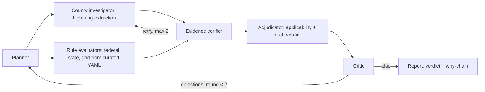

# SiteWhy

Check a US data center site against the rules that can block it — and see why.

Track: **The Agent That Can Explain Why**. SiteWhy screens a US address + IT load against federal, state, grid and county rules and returns a go / conditional / no-go verdict with the verified rule text, the applicability math, and what would change the answer. This is a screening tool, not legal advice.

## Demo video


## Problem

Data-center moratoria are spreading faster than any developer can track: 321 moratoria or restrictions across 32 states as of September 2026 (Electric Choice tracker, https://www.electricchoice.com/datacenters/moratoriums/), plus a New York statewide moratorium under Executive Order 62 (7/2026). Listing tools (Acres.com, Cherre DataCenter Intel, LightBox, Transect, C&W Athena) list rules and scores but do not reason about whether a rule applies to your site. SiteWhy answers the harder question: which rules apply to *this* site at *this* MW, with the quote, the threshold math, and the flips that would change the verdict.

## Users

Site selectors and developers triaging US greenfield sites before spending on legal and interconnection queues.

## What SiteWhy does that listing tools do not

- Deterministic applicability: every rule is evaluated in Python against project facts (e.g. Title V applies when the estimated NOx potential to emit clears 100 tpy; Texas SB 6 applies at 75 MW or more), never by model vibes.
- Verified quotes: each claim carries the verbatim rule text, source URL and as-of date; an unverified claim is downgraded instead of trusted: a fatal finding without a verified quote becomes major (`app/orchestrator.py:479-481`).
- Computed flips: each decisive finding shows what would change it (permit timing, MW threshold, moratorium expiry, incorporated vs unincorporated scope).
- Critic loop: a red-team critic objects to the draft verdict and the planner re-investigates targeted questions before the final report.

## Architecture and agent roles



| role | model / implementation | reads | writes |
|---|---|---|---|
| Planner | Nemotron Ultra | jurisdiction, project facts, critic objections | investigation tasks per layer |
| County investigator | Lightning for extraction through the Markovian chunked loop; Ultra re-extracts when Lightning returns no facts | tasks, seed layers, fetched sources | candidate rules + claims with quotes |
| Evidence verifier | deterministic code: verbatim quote substring match against the fetched source | claims | verified / not_found / unverifiable per claim |
| Applicability tool | deterministic Python | rules, project facts | applies yes/no + computed values |
| Adjudicator | Nemotron Ultra | verified claims, applicability results | draft verdict + why-chain |
| Critic | Nemotron Ultra, red-team prompt | draft verdict + World Model graph | objections → planner re-investigates |

Roles share one state store (the World Model log, per-run JSONL). Every message between roles is a typed event shown in the UI trace (the client polls every 1.5 s). Federal, state and grid rules come from curated YAML evaluated by code; only the county investigator calls a model. Live screenings run one at a time; a cooperative 10-minute (600 s) deadline returns a partial `needs_confirmation` report, and a second concurrent POST is refused with 409.

## Sponsor tech

- **Meterless Nightshift (primary AI provider).** Every model call goes through Nightshift (`app/llm.py`); no bypass. Per-request model and compute receipt are recorded in `model_trace` and shown in the UI agent lanes. Each sponsor call has a timeout with retry handling.
- **NVIDIA Nemotron.** `nvidia/nemotron-3.5-lightning-30b-a3b` handles extraction for the county investigator; `nvidia/nemotron-3-ultra-550b-a55b` handles planning, synthesis (adjudication) and critique. Quote verification is deterministic code (verbatim match in `app/evidence.py`), not a model call; the `classify`/`verify_support` entries in `STEP_MODELS` are unused.
- **Zetaris (data layer).** The agents query Zetaris moratoria + state_legislation tables at run time; every recorded live run succeeded with the request headers the app sends (see `data_trace` in `samples/*.json`, including the 50 MW run). DuckDB serves the same SQL when Zetaris is unreachable (`app/data.py`). The Unified Semantic Layer below is a separate, demonstrated artifact not yet queried by the agent loop.
- **Meterless World Model.** The shared, provenance-stamped rule/evidence graph every agent reads and writes (`app/worldmodel.py`, Apache-2.0 spec); each run appends a JSONL audit log.
- **Meterless Markovian.** Bounded-context chunked reasoning drives the county investigation (`app/markovian.py`, conformance + behavior tests). Recorded runs span up to 4 Markovian chunks in the sample-mode replays (2 in the live showcase samples), with 0 tokens saved at current source sizes; the engine and its accounting are implemented and tested.
- What was unique: the applicability engine and critic loop sit between model calls. Models propose and deterministic code disposes, so every verdict traces to a quote plus arithmetic rather than to a completion.
- Cursor: the `Dockerfile` and `.dockerignore` were written in a Cursor Agent CLI session (commit `30d5b90`); the rest was built with Claude Code.

## Zetaris Unified Semantic Layer

`SITEWHY.usl_site_screen` (1,291 rows, one per moratorium instrument) joins four registered sources: `moratoria`, `state_legislation`, `curated_rules` (from `data/layers/rules.yaml`), `county_sources` (from `data/layers/county_sources.yaml`). DDL in `zetaris/usl.sql`, automation in `scripts/zetaris_usl.py`, exploratory queries per source plus USL-active queries and run receipts in `zetaris/evidence/`. One data-quality rule (`null_join_keys`) executes on every build and passes when zero rows come back.

Honest note: plain Spark views do not persist across SQL-editor proxy requests on this Zetaris instance, so the USL is materialized — the build query renders to `data/seed/usl_site_screen.csv` and is registered as a Lightning filestore table. See `zetaris/REFLECTION.md` for time-saved analysis, where the USL helps or not, and the requirement for making it stronger.

## Evaluation

- Ground truth: 3/3 sites (Washington County MD unincorporated, Abilene TX/ERCOT, Tucson/Pima AZ) — `data/eval/results.json`.
- Seeded critic faults caught: 3/3 (`fatal-pima`, `title-v-below-threshold`, `washington-missed-exemption`) — `data/eval/results.json`. This eval is a regression check on the development sites, not a held-out accuracy number.
- Test suite: 177 passed (`uv run pytest -q`, 2026-10-27).
- Recorded model usage across the 5 samples in `samples/*.json` (counts from `model_trace` in those files):

| model | calls | total_tokens | latency_ms_total |
|---|---|---|---|
| nvidia/nemotron-3-ultra-550b-a55b | 20 | 127037 | 979744 |
| nvidia/nemotron-3.5-lightning-30b-a3b | 12 | 62333 | 80927 |
| **total** | **32** | **189370** | **1060671** |

Latency totals are wall-clock sums across recorded runs, not a benchmark.

## Dependencies

Python 3.12+, `uv`. Runtime: fastapi, uvicorn, httpx, duckdb, pypdf, beautifulsoup4, pyyaml (see `pyproject.toml`). Dev: pytest, pytest-asyncio, ruff. No local GPU needed.

## Run with Docker

```bash
docker build -t sitewhy .
docker run -p 8000:8000 sitewhy
```

The image runs in sample mode by default (no credentials needed). For live mode, pass keys with `--env-file` and point Nightshift/Zetaris at `host.docker.internal`.

## Setup

```bash
git clone <repo-url> sitewhy && cd sitewhy
uv sync
```

### Quick start in SAMPLE_MODE with no keys

Sample mode runs the whole app with no Zetaris, no Nightshift and no credentials. The real orchestration, verification and applicability code runs; model answers are replayed from recorded Nightshift responses, so verdicts (and call counts) can differ from the recorded showcase reports. Dates pin to `SAMPLE_MODE_AS_OF` (2026-10-26, `app/config.py`), the day the committed caches were recorded. Programmatic entry:

```bash
SAMPLE_MODE=true uv run python run.py --input input_examples/md-washington-county-unincorporated.json --sample --output /tmp/report.json --logs-dir /tmp/traces
```

This prints the report JSON to stdout (verified 2026-10-27: exit 0, verdict `no-go`), writes it to the output path (default `logs/<run_id>.json`, local only), and saves the agent trace JSONL to the logs dir. Four inputs ship under `input_examples/`; matching generated outputs under `output_examples/`; committed reference trace snapshots under `output_examples/traces/`.

With the server up (`SAMPLE_MODE=true uv run uvicorn app.main:app --port 8000`), open `http://localhost:8000` and pick a showcase site ("Sample mode: runs replay recorded model answers for the showcase addresses."), or drive it programmatically:

```bash
curl -s -X POST localhost:8000/runs -H 'content-type: application/json' \
  -d @input_examples/md-hagerstown-city.json
curl -s localhost:8000/portfolio | python3 -c "import json,sys; print(len(json.load(sys.stdin)), 'showcase reports')"
```

### Live mode with Zetaris + Nightshift

Copy `.env.example` to your keys file (outside the repo, never committed) and fill in:

- `NIGHTSHIFT_BASE_URL` (default `http://127.0.0.1:8088/v1`), `NIGHTSHIFT_TOKEN_FILE` or `METERLESS_RUNTIME_TOKEN`
- `ZETARIS_BASE_URL`, `ZETARIS_ORG_ID`, `ZETARIS_API_KEY`

Data setup is automated: `scripts/zetaris_usl.py` registers the seed tables and builds the USL (DDL in `zetaris/usl.sql`); when Zetaris is unreachable, DuckDB serves the same SQL from the bundled seed data. Then:

```bash
uv run uvicorn app.main:app --port 8000
```

Without keys the app boots and live features report "not configured" instead of crashing.

## Usage

### Programmatic entry

`run.py` (`--input/--sample/--output/--logs-dir`; `--help` for details) or the API:

```bash
curl -s -X POST localhost:8000/runs -H 'content-type: application/json' \
  -d '{"address":"100 W Washington St, Hagerstown MD 21740","mw":300}'
curl -s localhost:8000/portfolio | python3 -c "import json,sys; print(len(json.load(sys.stdin)), 'showcase reports')"
```

Failures return a useful JSON message, not a stack trace; a second concurrent POST is refused with 409 while a screening holds the run lock; an unknown address in sample mode errors immediately naming `input_examples/`.

### Input / output examples and traces

`input_examples/` holds the 4 showcase inputs (addresses + MW + permits exactly as recorded). `output_examples/` holds the reports produced by `run.py --sample` — generated, not copied. `output_examples/traces/*.jsonl` holds the committed reference traces: one JSON object per line per agent event with `timestamp, agent_name, action, input_summary, output_summary, target_agent, model, retry_count, status`; the target agent is the next event's role (real handoffs) and the model is that role's model from `model_trace`. Local runs write fresh traces to `logs/` (git-ignored). Each `samples/*.json` showcase report likewise carries `model_trace` (model per request), `markovian_runs` and `events`.

### Sample input / output

Recorded showcase reports (`samples/`, live Nightshift runs) versus sample-mode replays (`output_examples/`, cached replay pinned to 2026-10-26):

| sample | input | recorded verdict | replay verdict |
|---|---|---|---|
| `md-washington-county-unincorporated` | 13820 Pennsylvania Ave, Hagerstown MD 21742 · 300 MW · permits not submitted (recorded 2026-10-25) | no-go | no-go |
| `md-hagerstown-city` | 100 W Washington St, Hagerstown MD 21740 · 300 MW (recorded 2026-10-25) | conditional | needs_confirmation |
| `tx-abilene-ercot` | 555 Walnut St, Abilene TX 79601 · 300 MW (recorded 2026-10-25) | conditional | conditional |
| `tx-abilene-ercot-50mw` | same site · 50 MW (recorded live 2026-10-27, 2 Nemotron calls; no cached replay) | conditional | — |
| `az-tucson-pima` | 255 W Alameda St, Tucson AZ 85701 · 300 MW (recorded 2026-10-25) | conditional | conditional |

The 50 MW contrast: the same Abilene site at 50 MW stays conditional with a different rule mix (SB 6 and the ERCOT audit flip while Title V still applies). The scope flip is the headline demo: the same county, two answers — unincorporated Washington County is no-go under county moratorium ORD-2026-12, while incorporated Hagerstown is conditional because the county ordinance does not cover the city. Showcase reports carry a "Recorded run" badge with the run date.

## Screenshots


## Limitations

- Borderline cases can change verdict between runs: md-hagerstown-city was recorded as conditional (round 2), while the cached replay used by sample mode reaches needs_confirmation; both are real runs.
- Sample mode replays recorded model answers: the orchestration, verification and applicability code runs for real, but the LLM text comes from cache, so a sample-mode verdict can differ from the showcase report for the same input.
- Recorded model time is about 1.5–3 minutes for most sites (about 6 minutes for Hagerstown), against the 10-minute (600 s) cooperative deadline; a run that exceeds it stops with a partial `needs_confirmation` report.
- Title V applicability is an assumption-based estimate: potential to emit from assumed backup generators (N+1 units of 2.5 MW diesel, 500 h/yr, 6.4 g/kWh NOx) against the 100 tpy threshold, flipping between 25 and 26 MW. The 75 MW figure is the Texas SB 6 / ERCOT large-load threshold, not Title V.
- The Zetaris USL is a separate, demonstrated artifact (`scripts/zetaris_usl.py`); the agents do not query it yet.
- County sources are a draft ordinance, a press release and a news article — not adopted-ordinance text — with quotes verbatim-verified against them.
- Markovian saved 0 tokens on current sources (recorded runs span up to 4 chunks in the replays, 2 in the live samples); the engine is implemented and tested, the efficiency story is not yet demonstrated on real runs.
- Seed rules are curated with runtime-verified quotes; autonomous agent rule discovery is roadmap.
- Coverage: any US address is resolved and screened against the federal Title V rule and the 1,291-entry moratorium dataset; state and grid rules are modelled for Texas/ERCOT; county sources (draft ordinance, press release, news article) cover Washington County MD and Pima County AZ, with quotes verbatim-verified against them. Other states get a federal-only report with an explicit scope note (UI: "AI agents check federal, state, grid and county rules where modelled").
- Live screenings run one at a time with a 10-minute (600 s) cooperative deadline; a run that exceeds it stops with a partial `needs_confirmation` report, and the client poll loop gives up 60 s later with "The run did not finish in time — try again".
- Nothing here is production-ready: no auth, no multi-user, US only.

## Data licenses

| data | source | license |
|---|---|---|
| Moratorium inventory (1,291 entries) + state legislation (440 rows), `data/seed/moratorium_nation/` | Moratorium Nation by Michael Bommarito, refreshed 2026-09-23 | CC-BY-4.0 (data) |
| County→utility subset, `data/seed/` built by `scripts/build_geo.py` | U.S. EIA Form 861 2025 | Public domain |
| Geocoder cache | U.S. Census Geocoder | Public domain |
| County/place context | U.S. Census TIGERweb | Public domain |
| Transmission lines | HIFLD Electric Power Transmission Lines | Public domain |
| Map tiles | Esri Dark Gray Canvas / World Imagery | Esri proprietary, attribution shown on map |
| Cached source texts (6 files), `data/sources/` | fetched public pages (governor press releases, county notices), cached at record time for sample-mode replay | same terms as the underlying public pages |

World Model and Markovian engine specs: Meterless, Apache-2.0. Pre-existing third-party material (pre-window datasets + Meterless specs) is declared in the submission; no pre-existing product code.

## Troubleshooting

- `Nightshift is not configured (token missing)`: set `NIGHTSHIFT_TOKEN_FILE` or `METERLESS_RUNTIME_TOKEN` in `~/.hackathon-keys.env`, or run with `SAMPLE_MODE=true` / `run.py --sample`.
- `Zetaris is not configured`: set `ZETARIS_BASE_URL`, `ZETARIS_ORG_ID`, `ZETARIS_API_KEY`; DuckDB serves the bundled seed data meanwhile.
- No `.env` file is needed or read: configuration comes from the environment and `~/.hackathon-keys.env`.
- Port in use: serve on another port, e.g. `SAMPLE_MODE=true uv run uvicorn app.main:app --port 8010`.

## Development

```bash
uv run pytest -q
uv run ruff check .
```

## License

No license file yet; the entrant keeps all IP. Third-party data and engine specs keep their own licenses, see above.
