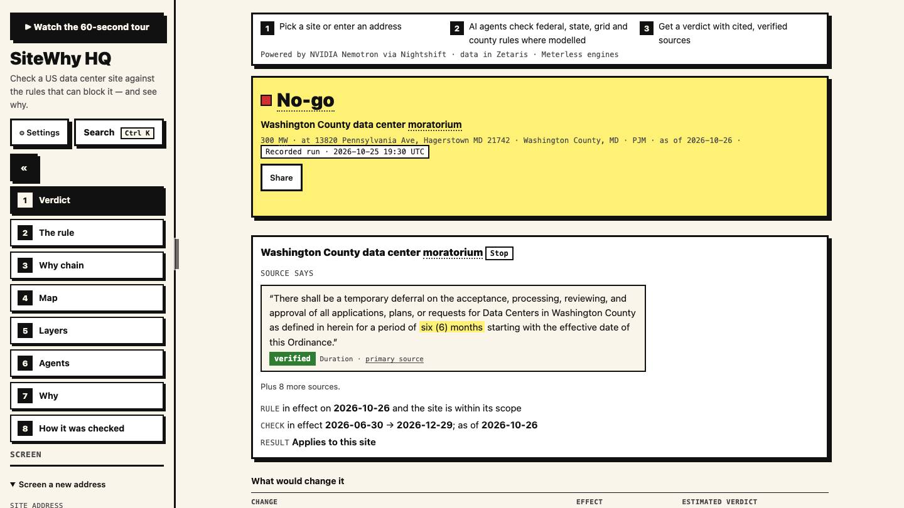
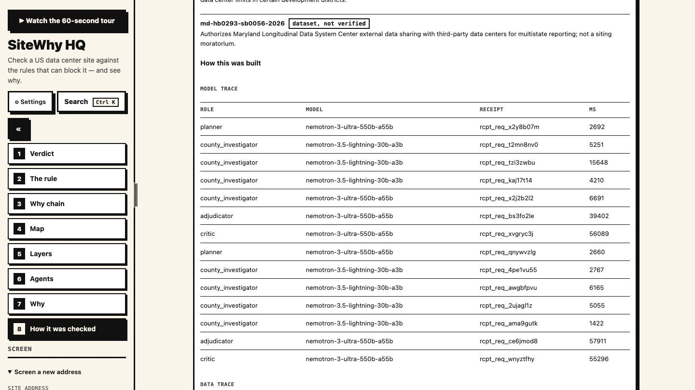

---
layout: cover-typographic

# SiteWhy
---

---
layout: big-number

## Data center moratoria and the site-selection bottleneck

| Moratoria or restrictions | States with limits | Statewide moratorium |
|---|---|---|
| 321 | 32 | NY Executive Order 62 |
| Sep 2026, Electric Choice | Sep 2026, Electric Choice | Jul 2026 |

> Moratorium counts, Electric Choice, September 2026; New York Executive Order 62, July 2026

- Site selectors and developers triage US greenfield sites before spending on legal review and interconnection queues.
- Listing tools (Acres.com, Cherre DataCenter Intel, LightBox, Transect, C&W Athena) list rules and scores but do not reason about whether a rule applies to a site.
- SiteWhy answers the harder question: which rules apply to this site at this MW, with the quote, the threshold math, and the flips that would change the verdict.
- Source: README problem statement; judging evidence impact.md
---

---
layout: image-split

## Verdicts with the rule, the math and the flip

- **Verdict** go, conditional or no-go for a US address plus IT load, with the verified rule text, the applicability math, and what would change the answer.
- **Track** The Agent That Can Explain Why: every verdict traces to a quote plus arithmetic, never to a completion alone.
- **Scope** federal Title V, a 1,291-entry moratorium dataset, Texas and ERCOT state and grid rules, verified county ordinances for Washington County MD and Pima County AZ.
- A screening tool, not legal advice.
- Source: README; samples/*.json
---

---
layout: process

## Agent workflow from address to verdict

- **1. Plan** the planner drafts investigation tasks per layer on Nemotron Ultra
  (1) Input: address, MW, jurisdiction match
  (2) Output: per-layer tasks for federal, state and county investigators
- **2. Investigate** layer investigators gather candidate rules with quoted text
  (1) Lightning extraction; the county loop uses Markovian chunked reasoning
  (2) Output: candidate rules with quotes and source locators
- **3. Verify** deterministic quote check plus Lightning verify_support, retry at most twice
  (1) Unverifiable claims become needs_confirmation, never fatal verdicts
  (2) Output: verified, not_found or unsupported per claim
- **4. Decide** applicability in Python, draft verdict, critic re-investigates objections
  (1) Adjudicator and critic run on Nemotron Ultra
  (2) Output: verdict with the why-chain and the flips table
- **5. Trace** every message is a typed event in the shared World Model log; one run at a time with a 5-minute cooperative deadline
  (1) The log streams to the UI lanes with the model and receipt per request
  (2) Output: model_trace, markovian_runs and events in every sample
- Source: README architecture; app/orchestrator.py; app/llm.py
---

---
layout: table-insight

## Technical stack

| Layer | Choice |
|---|---|
| App | FastAPI and uvicorn; SAMPLE_MODE serves the recorded showcase reports |
| Data | Zetaris SITEWHY tables; DuckDB serves the same SQL when unreachable |
| AI provider | Meterless Nightshift for every model call, with a per-request receipt |
| Models | Nemotron Lightning 30B for extraction and verification; Nemotron Ultra 550B for planning and critique |
| Engines | World Model provenance log; Markovian county reasoning loop |

> Stack as shipped, October 2026

- One run at a time; a run past its 5-minute deadline returns a partial needs_confirmation report instead of hanging.
- No local GPU needed; Python 3.12 with uv.
- Source: README; app/llm.py STEP_MODELS; app/data.py
---

---
layout: kpi-row

## Zetaris and Meterless integration

| Moratorium rows | Legislation rows | Traced model calls |
|---|---|---|
| 1,291 | 440 | 30 |
| Zetaris SITEWHY tables, Sep 2026 | Zetaris SITEWHY tables, Sep 2026 | model_trace across 5 samples |

> Zetaris seed tables and recorded model usage, October 2026

- Nightshift is the primary AI provider; model and compute receipt per request appear in the UI agent lanes.
- World Model: a shared provenance-stamped rule graph with a per-run JSONL audit log.
- Markovian: bounded-context chunked county investigation, conformance-tested; current single-chunk sources save 0 tokens.
- Cursor: <to confirm>
- Source: README sponsor tech; samples/*.json model_trace
---

---
layout: comparison

## Deterministic checks between model calls

:::: columns 1fr 1fr
::: col
- **Rule-listing tools**
  (1) List rules and scores for an area
  (2) Leave the applicability question to the reader
  (3) Keep no record of which model said what
:::
::: col
- **SiteWhy**
  (1) Models propose candidate rules; Python decides applies yes or no
  (2) Each claim carries the verbatim quote, source URL and as-of date
  (3) Computed flips show what would change the verdict; the critic re-investigates
:::
::::

- Models propose, deterministic code disposes, so every verdict traces to a quote plus arithmetic.
- Source: README; judging evidence why.md and tech.md
---

---
layout: kpi-row

## Evaluation and honest limits

| Ground truth sites | Seeded critic faults | Recorded samples | Test suite |
|---|---|---|---|
| 3 / 3 | 3 / 3 | 5 | 153 passed |
| Washington MD, Abilene TX, Tucson AZ | fatal-pima, title-v, washington-exemption | 4 at 300 MW plus Abilene at 50 MW | pytest, 27 Oct 2026 |

> data/eval/results.json; samples/*.json; pytest run 2026-10-27

- Markovian saved 0 tokens on current sources; the engine and its accounting are implemented and tested.
- Seed rules are curated with runtime-verified quotes; autonomous rule discovery is roadmap.
- Coverage is modelled for Texas and ERCOT plus two counties; other states get a federal-only report with an explicit scope note.
- Source: data/eval/results.json; README limitations
---

---
layout: image-split

## A no-go with its verified rule

- **Finding** Washington County MD unincorporated at 300 MW is no-go under county moratorium ORD-2026-12.
- **Evidence** verbatim quote with a verified badge, duration and primary source, then the in-effect check and applies-to-site result.
- **Badge** showcase reports carry a Recorded run mark with the UTC date; live runs carry none.
- Source: samples/md-washington-county-unincorporated.json
---

---
layout: image-split

## Incorporated city versus unincorporated county

- **Flip** the Hagerstown city site is conditional because the county ordinance does not cover the city.
- **Math** the flips table shows that at 25 MW instead of 300 MW the Title V finding changes yes to no, with estimate badges on computed lines.
- The scope flip is the headline the demo leads with.
- Source: samples/md-hagerstown-city.json
---

---
layout: image-split

## Every model call on the record

- **Trace** each row names the agent role, the Nemotron model, the compute receipt and the latency.
- **Roles** Lightning handles extraction and verification; Ultra handles planning, synthesis and critique.
- 30 traced calls across 5 samples: 18 Ultra and 12 Lightning.
- Source: samples/*.json model_trace; README evaluation
---

---
layout: table-insight

## Recorded samples and verdicts

| Sample | Input | Verdict |
|---|---|---|
| md-washington-county-unincorporated | 13820 Pennsylvania Ave, Hagerstown MD 21742, 300 MW | no-go |
| md-hagerstown-city | 100 W Washington St, Hagerstown MD 21740, 300 MW | conditional |
| tx-abilene-ercot | 555 Walnut St, Abilene TX 79601, 300 MW | conditional |
| tx-abilene-ercot-50mw | Same Abilene address, 50 MW | conditional |
| az-tucson-pima | 255 W Alameda St, Tucson AZ 85701, 300 MW | conditional |

> samples/*.json, recorded 25 Oct 2026

- Four sites at 300 MW plus a 50 MW contrast at the same address; verdicts match the data/eval ground truth on the 3 checked sites.
- Each sample carries model_trace with the model per request, plus markovian_runs and events.
- Source: samples/*.json
---

---
layout: table-insight

## Planned enhancements and current scope

| Enhancement | Why it matters |
|---|---|
| Agent rule discovery | Replace curated seed rules with runtime-verified discovery |
| More states and ISO rules | Extend beyond Texas and ERCOT plus two counties |
| Quote-to-value alignment check | Verify the numbers, not just quote presence |
| Multi-chunk Markovian demo | Show token savings on larger sources |
| Dockerfile judge path | One-command sample-mode run for judges |

> Roadmap as of 27 Oct 2026; none of this changes the recorded verdicts above

- Current scope stays honest: no accuracy claims beyond the measured 3/3 ground truth and 3/3 seeded faults.
- Pre-window datasets and the Meterless specs are declared as pre-existing third-party material.
- Source: plans/m4-submission.md; README limitations
---

---
layout: closing-statement

## The track and the team

Track: The Agent That Can Explain Why. Solo team SiteWhy. Every verdict traces to a quote plus arithmetic.
---
